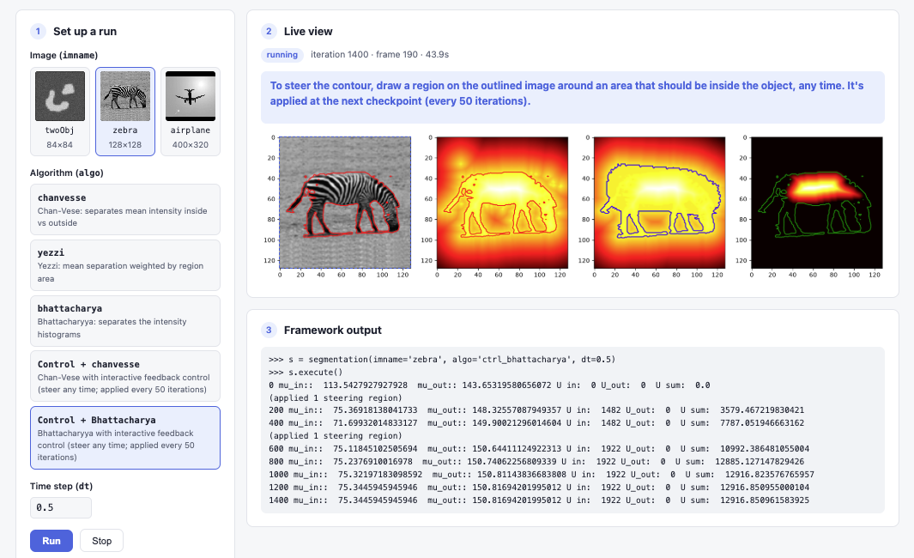

# Level Set Segmentation Framework

> ### *also known as Snakes*

PDE-based image segmentation by level set evolution, with interactive feedback control and a browser view to watch the contour evolve live.



<sub>The browser view during a Control + Bhattacharya run on `zebra`: the contour (left), `phi`, `phi_hat` and the user input `U`, with the framework's output below.</sub>

---

## Contents

- [Features](#features)
- [Quick start](#quick-start)
- [Using the browser view](#using-the-browser-view)
- [Running from Python](#running-from-python)
- [Algorithms](#algorithms)
- [How it works](#how-it-works)
- [Project structure](#project-structure)
- [Configuration](#configuration)
- [Troubleshooting](#troubleshooting)
- [License](#license)

## Features

- **Three energy functionals:** Chan-Vese, Yezzi and Bhattacharyya, plus interactive feedback control for Chan-Vese and Bhattacharyya.
- **Freeform starting region:** draw the initial contour by hand around the object.
- **Interactive steering:** with the Control algorithms, mark areas that belong inside the object while the contour evolves.
- **Browser view:** one command sets everything up and streams the evolution to a web page.
- **Pluggable schemes:** each functional is a self-contained class in `schemes.py`.

## Quick start

```bash
git clone https://github.com/ibipul/segmentation-2Dsnakes-wt-interactive-control.git
cd segmentation-2Dsnakes-wt-interactive-control
./run.sh
```

Requires Python 3.11 or newer. The first run creates a virtual environment in `.venv` and installs the pinned packages from `requirements.txt`. The page then opens at **http://localhost:8090**, or the next free port; the terminal prints the address. Keep the terminal open while you use the page, and press Ctrl+C there to stop.

## Using the browser view

1. **Pick an image and an algorithm.** Leave `dt` at 0.5 unless you want bigger or smaller steps.
2. **Press Run, then draw the starting region** on the image: press, drag around the object, release. The contour then evolves live.
3. **Steer (Control algorithms only).** With **Control + chanvesse** or **Control + Bhattacharya**, draw a region on the outlined image around an area that should be inside the object, at any time. It shows as a dashed yellow outline until it is applied at the next checkpoint, every 50 iterations.
4. **Press Stop** to end a run, or **Run** again to start over.

The page also shows the exact Python call it runs, and the framework's progress output.

## Running from Python

Install the packages (`./run.sh` does this for you):

```bash
pip install -r requirements.txt
```

Then run the framework directly. It opens matplotlib windows, and you draw the starting region with the mouse:

```python
from seg_fwk import segmentation

s = segmentation(imname='twoObj', algo='yezzi', dt=0.5)
s.execute()

s = segmentation(imname='zebra', algo='bhattacharya', dt=0.5)
s.execute()

s = segmentation(imname='airplane', algo='chanvesse', dt=0.5)
s.execute()

s = segmentation(imname='airplane', algo='ctrl1', dt=0.5)
s.execute()

s = segmentation(imname='zebra', algo='ctrl_bhattacharya', dt=0.5)
s.execute()
```

| Parameter | Options |
|---|---|
| `imname` | `twoObj`, `zebra`, `airplane` |
| `algo` | `chanvesse`, `yezzi`, `bhattacharya`, `ctrl1`, `ctrl_bhattacharya` |
| `dt` | Time step, e.g. `0.5` |

When run from Python, the Control algorithms pause every 200 iterations and open a lasso for a steering region; close the window to continue without one.

## Algorithms

| `algo` | Name in the page | What drives the contour |
|---|---|---|
| `chanvesse` | chanvesse | Maximizes the difference between the mean intensity inside and outside |
| `yezzi` | yezzi | Mean separation, weighted by the area of each region |
| `bhattacharya` | bhattacharya | Minimizes the overlap of the inside and outside intensity histograms (Bhattacharyya coefficient) |
| `ctrl1` | Control + chanvesse | Chan-Vese with interactive feedback control |
| `ctrl_bhattacharya` | Control + Bhattacharya | Bhattacharyya with interactive feedback control |

## How it works

**Level sets.** The contour is stored implicitly as a 2D function `phi` the size of the image; the contour is where `phi = 0`. Each iteration moves `phi` by an image force from the chosen functional plus a curvature term that keeps the contour smooth. Only a narrow band of pixels near the contour is updated. Every 10 iterations `phi` is re-initialized with Sussman redistancing, and the figure is redrawn.

**Feedback control.** The Control algorithms evolve three fields together:

| Field | Role |
|---|---|
| `phi` | The segmentation contour. Driven by the image force, curvature, and a pull toward `phi_hat`. |
| `phi_hat` | A reference contour. Pulled toward `phi` and toward the user's input `U`. |
| `U` | User input. Each steering region adds to `U` inside it, followed by a median filter. |

Your steering regions move `phi_hat`, and `phi_hat` pulls the contour toward the areas you marked.

**Browser view.** `web/server.py` runs the framework unchanged. Before importing it, it replaces `plt.pause`, `plt.show` and `LassoSelector`, so figures render off screen and stream to the page, and lasso requests are answered by drawings from the page.

## Project structure

```
.
├── run.sh               # one-command launcher for the browser view
├── requirements.txt     # pinned dependencies
├── seg_fwk.py           # entry point: segmentation(imname, algo, dt).execute()
├── schemes.py           # energy functionals and the control schemes, plug and play
├── initialize_phi.py    # distance-function initialization from the drawn starting region
├── redistance.py        # Sussman redistancing PDE for level sets
├── curvature_term.py    # mean-curvature term
├── test_driver.py       # minimal example run
├── web/
│   ├── server.py        # runs the framework and streams its figures (FastAPI)
│   └── index.html       # the browser page
├── docs/web-view.png    # screenshot used in this README
└── airplane.png, twoObj.bmp, zebra.bmp   # sample images
```

## Configuration

| Setting | Default | Effect |
|---|---|---|
| `PORT=9000 ./run.sh` | First free port from 8090 | Use exactly this port |
| `NO_BROWSER=1 ./run.sh` | Opens the browser | Start the server without opening the page |
| `PYTHON=/path/to/python3.11 ./run.sh` | First Python 3.11+ found | Use a specific interpreter |
| `seg_w_control._steer_every` | 200 (50 in the page) | Iterations between steering checkpoints, a multiple of 10 |
| `seg_w_control._log_every` | 200 | Iterations between progress lines, a multiple of 10 |

## Troubleshooting

| Message from `run.sh` | What to do |
|---|---|
| `Python 3.11 or newer is required` | Install a newer Python, or point to one: `PYTHON=/path/to/python3.11 ./run.sh` |
| `Package install failed` | Usually a network problem. Run `./run.sh` again; if it keeps failing, delete `.venv` and retry. |
| `An earlier run of this app is already serving …` | Use that address, or stop it (Ctrl+C in its terminal) and run `./run.sh` again. |
| `Port … is in use by another program` | Pick another port: `PORT=9000 ./run.sh` |

## License

Released under the [GNU General Public License v3.0](LICENSE).
